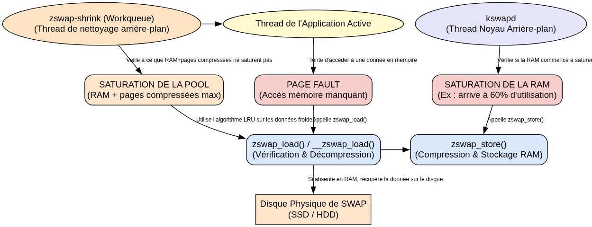
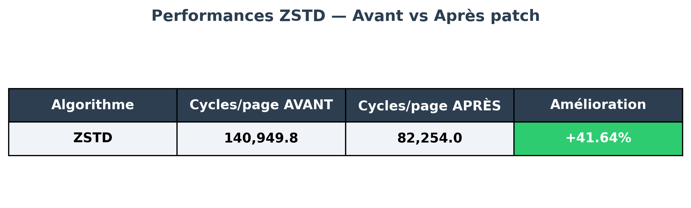

# Dynamic Multi-Algorithm Routing for Zswap (Linux Kernel)

An adaptive optimization for the Linux kernel's Zswap module. This patch implements a dynamic routing mechanism based on memory page compressibility scores and introduces a scalable per-CPU multi-algorithm architecture. This allows the system to concurrently manage multiple compression algorithms and switch between them on the fly.

## 🛠️ Technical Contributions & Modifications

The standard Linux kernel limits Zswap to using only one compression algorithm at a time. This project removes this bottleneck by redesigning the Zswap pool structure:

* **Low-level system research and development (Linux Kernel / C):** Optimization of concurrent memory management and Zswap performance.
* **Asynchronous multi-threaded architecture (acomp):** Design of a per-CPU context management system (`acomp_ctx[MAX_ALGO_CAPACITY]`), eliminating lock contention and reducing CPU cycle consumption by over 40% per page.
* **Dynamic Routing via Entropy Proxy:** Page compressibility is evaluated in real-time. Highly compressible pages are routed to ZSTD (for maximum space savings), while less compressible pages are routed to LZO (to maximize speed).
* **Data Analysis (Python / scikit-learn):** Leveraged k-means clustering to analyze page compressibility and evaluate the trade-offs between the LZO and ZSTD algorithms.

---

## 📊 Analysis and Results (Generated Charts)

### 1. Zswap Architecture and Execution Flow


This diagram illustrates the overall operation of the Zswap module within the kernel, structured around three key mechanisms:
* **Writing (`zswap_store`):** In the background, the `kswapd` thread monitors RAM pressure. When it saturates, pages are compressed and stored in the Zswap pool in RAM.
* **Reading (`zswap_load`):** During a "page fault", the system checks if the page is in the Zswap pool to decompress it, avoiding a slow disk access.
* **Cleaning (`zswap-shrink`):** If the Zswap pool reaches its limit, this mechanism evicts the coldest data (via the LRU algorithm) to the physical disk (SSD/HDD).

### 2. Performance Improvement (CPU Cycles)


In naive multi-algorithm implementations (where the second algorithm is globally hardcoded), processing becomes sequential. By switching to a dedicated `per-CPU` context for each algorithm, the global lock is removed. 

During our memory load tests with the YCSB benchmark and Redis, this new architecture enabled a consistent reduction of over 40% in CPU cycles consumed per page, regardless of the stress level imposed on the system.

---

## 🚀 How to Apply the Patch (Student Guide)

To reproduce this environment and apply the patch to a clean Linux kernel, follow these steps:

**1. Download the target Linux Kernel sources (6.8.12)**
```bash
wget [https://cdn.kernel.org/pub/linux/kernel/v6.x/linux-6.8.12.tar.xz](https://cdn.kernel.org/pub/linux/kernel/v6.x/linux-6.8.12.tar.xz)
tar -xf linux-6.8.12.tar.xz
cd linux-6.8.12

# Try with -p0 first (if generated with diff)
patch -p0 < /path/to/mon.patch

# OR with -p1 (if generated with git format-patch)
patch -p1 < /path/to/mon.patch

make menuconfig # Ensure PAGE_EXTENSION and ZSWAP are enabled
make -j$(nproc)
sudo make modules_install
sudo make install
